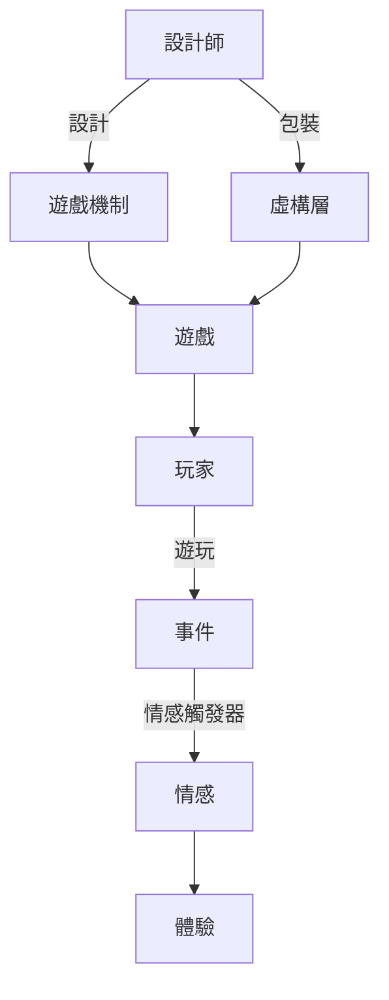
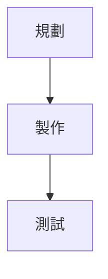
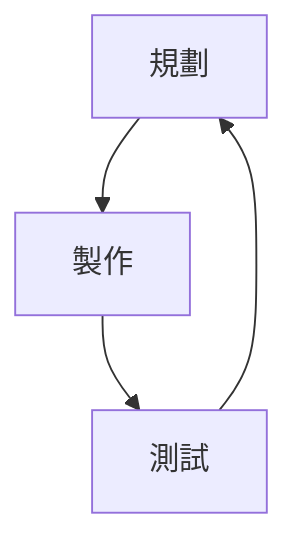

# 體驗引擎：遊戲設計全景探祕

> 2026/7/19->2026/9/6

## 第一部分 體驗引擎
### 第1章 體驗引擎
#### 遊戲機制和事件
- 遊戲設計師設計產生事件的遊戲機制體系，而其他大多數藝術形式直接設計事件
- 能夠激發情感的事件才有意義，這種情感通常細微到無法察覺
- 感知理解細微易變的情感是重要設計能力，因為情感是首要因素
- 遊戲中的情感絕不僅僅是有趣
- 人的潛意識會不斷分析當前狀況，達到條件時觸發對應情感
- 事件改變對主體有價值影響(human value)才會觸發情感
- 和情感有關的本質是事件帶來的人類價值改變，越重要或越頻繁，情感越強烈
- 思考即將發生的事件也會產生情感(緊張狀態)
- 遊戲中可通過隱藏和展示信息來改變人類價值

#### 情感黑盒
- 情感觸發器是潛意識的自動計算，主體自身也無法知道為什麼
- 人不知道為什麼產生情感，但依然會想當然地分配一個原因，往往是錯的，造成情感錯位
- 情感錯位舉例：房間配上不安的音樂會讓人覺得房間恐怖，但實際恐怖的是音樂。這恰好是一種設計技巧
- 情感錯位使遊戲對玩家的影響近乎不可知，這也是遊戲設計的困難所在

#### 情感觸發器
##### 學習的情感
- 學習慾望源於最初獲得更好繁衍機會的可能性
- 人類價值越大的知識，學習驅動力越強
- 越難掌握的知識，學會的成就感越大
- 新的信息可以揭示舊信息時，可以獲得領悟(insight)
- 調動學習情感最典型的是解謎遊戲

##### 角色弧線引發的情感
- 即人類的共情能力
- 通過劇情調動的情感，與小說電影等基本相同
- 這裏還包含了一種特殊的求知慾，人們尤其愛好角色的內心衝突，越強烈越有興趣

##### 挑戰引發的情感
- 遊戲中對技巧和力量的測試，可產生多種情感，是最常用的
- 挑戰並非遊戲的必需品，因為這不是人類的唯一情感

##### 社交引發的情感
- 社交行為可能包括炫耀、分享、惡作劇、合作等等，可以改變社會性的人類價值
- 遊戲本身可作為社交的良好媒介

##### 財富引發的情感
- 賭博通過真實的財富創造此類情感，而遊戲中虛擬的貨幣同樣可以

##### 音樂引發的情感
- 音樂極其微妙卻可源源不斷地產生情感
- 音效同樣也可產生情感

##### 場景特效引發的情感
- 大場面可迅速激發情感，但持續時間較短
- 適合擴大已有情感，憑空使用很容易變成亂砸錢搞特效

##### 美引發的情感
- 美可以讓人身心愉悅，但需要在適當的地方呈現，否則與特效的反作用類似

##### 環境引發的情感
- 季節、天氣、晝夜會直接傳達強烈的情感

##### 新技術引發的情感
- 新技術可為部分玩家直接帶來刺激的情感體驗
- 新技術很容易導致設計質量的下降，情況包括未完全掌握、沉迷於技術展示、忽視其他本應設計的情感體驗
- 過於依賴新技術的遊戲可能在技術成熟後失去價值
- 避免盲從新技術，而應該利用新技術解決問題或擴展設計維度

##### 原始威脅引發的情感
- 恐懼感源自人類底層的原始威脅，使用時簡單有效
- 由於恐怖類元素已被濫用，新設計必須推陳出新

##### 性暗示引發的情感
- 性是人類基因的一部分，使用時簡單有效
- 部分嚴肅遊戲或受衆群特殊時需慎重

#### 虛構層 The Fiction Layer
- 遊戲本質是各機制構成的系統，而通過虛構包裝帶來情感
- 玩家可以在意識到虛構的同時選擇相信，不耽誤情感的產生
- 遊戲機制可產生競爭、學習、社交等情感，虛構層了可產生諸如幽默、恐懼、沉浸感等，二者均有特長和限制
- 虛構和遊戲機制很容易互相影響，因此大多數遊戲會選擇側重一方。極端為純玩法的棋牌遊戲和純劇情的galgame
- 遊戲設計的最高境界是將遊戲機制和虛構完美結合

#### 構建體驗
- 體驗是指存在於玩家腦海中的情感、想法及決策

##### 純粹的情感
- 所有情感觸發器共同使用，將某種情感最大化

##### 並列
- 組合完全不同的幾種情感，有時可產生奇效
- 最簡單的方法是將遊戲背景音樂替換為完全不同風格的

##### 對立的情感
- 部分情感之間是對立的，如不能同時帶來社交的鬆弛感和競爭快感

##### 氛圍
- 情感可能完全不通過事件，而由場景營造的氛圍產生

##### 情感變化
- 任何一種情感持續一段時間都必須有所變化，形成節奏曲線
- 也可改變情感的效价valence及強度來實現變化

##### 心流flow
- 心流會加速時間，使真實世界剝離，並且總是令人愉悅
- 心流由連續微小的成功組成，在匹配玩家能力挑戰時出現
- 幾乎所有遊戲都要保證心流運轉，不好玩遊戲的問題幾乎都和心流消失有關

##### 沉浸immersion
- 沉浸指玩家與角色融為一體，所有角色發生的事件都變得意義重大
- 玩家與遊戲角色產生的體驗保持一致時，出現沉浸現象
- 兩因素情緒理論
    - 情緒產生需要兩個因素，1體驗到生理喚醒，如出汗、心跳加速，2個體對情緒進行判斷和標記
    - 所有強烈情感生理上沒有不同，只是標記不同
    - 對情緒的判斷和標記很容易出錯，如受外界影響
- 創造沉浸感的實際流程
    - 利用心流剝離現實世界，避免干擾
    - 通過遊戲機制的挑戰激發生理喚醒，隨便哪種，包括速度加快、困難抉擇、風險提高等等
    - 通過虛構層影響情緒標記，確保玩家進行情緒標記，且與遊戲角色設定一致
    - 達成一致體驗，出現沉浸

#### 體驗引擎

- 遊戲是一種製造體驗的人工系統，系統的目的是用於激發情感

## 第二部分 遊戲製作
### 第2章 優雅
#### 浮現emergence的優雅
- 通過簡單機制創造各種複雜情況，即遊戲機制間相互作用引發大量不同體驗
- 多種機制通過複雜且不明顯的方式交互，則是優雅的設計，也更困難

#### 判斷機制是否優雅
- 主要靠經驗積累後的直覺
- 部分規律
    - 優雅的機制通常會和更多其他機制交互
    - 越簡單的機制越可能優雅
    - 能以多種方式使用的機制可能優雅
    - 與其他機制作用不重複則可能優雅
    - 符合用戶習慣或複用的機制可能優雅
    - 優雅的機制可能和已存在機制規模類似
    - 可頻繁重複使用的機制可能優雅
    - 不對遊戲內容施加限制的機制可能優雅
- 優雅的機制有可能簡單甚至無趣，但一定能拓展可能性空間

### 第3章 技巧
#### 深度
- 深度為遊戲中可學習內容的多少
- 技巧只有在玩家沒完全掌握之前才有價值，並且玩家一定會想盡辦法解決
- 遊戲技巧上限超越人類極限，遊戲就是無止境的深度遊戲
- 深度可以不是遊戲中的唯一追求

#### 無障礙
- 技巧障礙skill barrier是玩遊戲必須掌握的技巧
- 只有高於技巧下限才能正常玩遊戲，而遊戲設計師經常低估無障礙的重要性

#### 技巧範圍
- 障礙與深度分別構成一個遊戲技巧範圍的下限與上限
- 擴展技巧範圍會大幅度提升遊戲設計難度。並非所有遊戲都必須有廣闊的技巧範圍，應設定一個最低技巧級別

#### 沒有明確目標的技巧
- 類似模擬人生、我的世界之類無目標遊戲也有技巧範圍，下限是基礎操作與內容理解，上限是遊戲過程中玩家自己設定的目標

#### 技巧範圍的延伸
- 簡單優雅的系統通常有較廣的技巧範圍
- 自我再造reinvention
    - 遊戲的不同階段對應不同的技巧
    - 手動階段manual聚焦於操作，情景階段situational聚焦於戰術，心理階段mental聚焦於戰略(主要為多人遊戲)
- 彈性挑戰Elastic Challenge：允許不同程度的成功或失敗
- 訓練
    - 通過教學及各種形式使玩家通過技巧障礙
    - 過於刻板的教學會讓玩家感覺脫離或被控制，最好的方式是潛移默化
    - 只有玩家需要時才進行教學，並且應可跳過
- 情感維持
    - 即使初期引導良好的遊戲也可能導致玩家放棄
    - 可使用不需要技巧的情感觸發器，如展示美、音樂、特效等
- 改變難度：可以顯式選擇難度，也可以使用適應性難度隱式調整，二者可共存。不同的通關策略也屬於隱式的難度選擇

#### 處理失敗
- 不要因為失敗而懲罰玩家，即避免純機制懲罰，應該用更好的方式產生緊張感
    - 可以制裁遊戲中的角色，表演被折磨的效果傳遞緊張
    - 可以有資源損失，但必須保證有其他路線可以走下去，而不是陷入循環重複
- 失敗陷阱：玩家長時間停留在某種必然失敗的狀況中(死檔)
    - 可提供一種類似磨血的機制
    - 可直接結束遊戲快速重新開始
    - 可降低難度或跳過挑戰
    - 部分體育競技類遊戲可能存在無法消除失敗陷阱的情況(垃圾時間)

### 第4章 故事
#### 故事敘述工具
- 故事敘述工具指能夠在玩家腦海中形成故事情節的裝置
- 遊戲有幾乎最全面的故事敘述工具

#### 腳本故事 scripted story
- 直接嵌入遊戲的線性故事，與傳統媒體敘事方式基本相同
- 最基本的是過場動畫，要警惕其對遊戲流程的干擾
- 軟腳本 soft scripting：即帶分支選擇的劇本
    - 優點是玩家仍有控制權，缺點是設計者失去了控制權

#### 世界性故事 world narrative
- 通過場景中的各種細節進行敘事
- 可通過展示已有或缺失的東西來說明情況
- 可通過文化特徵的關聯性來隱喻
- 場面調度mise-en-scène：通過殘留物解釋發生的事件，如一排屍體表示執行過槍決
- 可通過文字、語音、視頻碎片化敘事
- 在遊戲中，世界性故事是重要的工具
    - 可以避免影響遊戲節奏，同時降低成本
    - 允許非線性體驗，玩家遊玩更自由
    - 適合反復遊玩不斷體驗
- 世界觀的一致性
    - 世界觀越一致且內部聯繫越多，世界性故事的效果越好

#### 浮現的故事 emergent story
- 在遊戲過程中，通過遊戲機制與玩家交互所產生故事，即特定遊戲經歷
- 浮現的故事既是敘述的工具，也是產生故事內容的技術
- 實際就是遊戲中各種體驗的描述方式
- 只有浮現的故事能打破虛擬與現實的界限
- 妄想 apophenia：人類的特殊能力，可從複雜數據中獲取自己所需的內容(圖案)
    - 人類尤其熱衷於擬人化
    - 妄想為浮現的故事添加腦補內容
    - 展示內容越少，妄想空間越大
- 激發妄想的方法
    - 標識 labeling：通過簡單標識引發妄想，使玩家創造腦補內容，是優雅的敘事方法
    - 抽象 abstraction：通過抽象降低信息密度，以加大玩家的想象空間
    - 保存記錄：記錄浮現的事件，以備玩家查閱腦補
    - 體育解說：回顧浮現的事件並串聯，進行類似新聞報道式的說明。實現難度較大

#### 故事順序
- 通過關卡、任務或各類條件機制可控制遊戲中的故事順序

#### 故事結構
- 珍珠串：線性結構
- 中心輻射 Hub and Spokes：各子節點互不相關，均和中心節點交互。即需要完成多個支線才能繼續主線的結構
- 完全擴展開的結構無法控制，需要進行故事聚合story convergence，即世界線收束

#### 代理權問題 Agency Problem
- 遊戲玩家擁有代理權，可隨意影響遊戲世界
- 玩家會做出戲的事情
    - 不可簡單禁止，會感覺被限制
    - 可消除其反饋，使其自覺無趣
    - 可順水推舟做成彩蛋，但玩家可能得寸進尺
    - 最佳的方法是確保玩家與角色的動機一致，即確保虛構層的角色目標與遊戲機制玩家目標融為一體
 
### 第5章 決策
- 本章的決策指的是廣義的遊戲行為決策，而不是劇情選擇項的決策
- 遊戲的核心是交互，交互的核心是做出決策
- 決策是遊戲獨有的情感觸發器，是對未來感知的情感觸發器，可以創造期望
- 有意義的決策是結果能被部分預料，既不能全部也不能純隨機
- 決策可預測性的基礎是易理解且穩定的遊戲機制或外部系統，如物理系統等等
    - 穩定：系統規則穩定不變，如重力始終會讓物體下落
    - 易理解：如玩家學不會則無從預測
- 遊戲中角色的AI越簡單則越易預測，從而讓玩家易於決策，並非越擬真越好
- 信息平衡 information balancing：同樣的決策，通過提供或屏蔽信息以調整決策難度
    - 這種方式不改變遊戲機制，是優雅的方式
- 信息匱乏
    - 少數情況的信息匱乏可以是設計目的，如賭博元素通過隱藏信息以加強隨機性的刺激
    - 準備挑戰：挑戰前的策略選擇很容易信息匱乏，如rpg遊戲選擇角色類型。這種問題很難解決，且玩家的決策一定是選擇最容易理解的或默認的
    - 虛構層：當虛構層無法有效傳遞信息時，只能跳出虛構層而直接描述，避免造成信息匱乏
    - 聯網攻略會解決信息匱乏，但同樣也證明了問題所在
    - 信息匱乏具有隱蔽性
        - 因為設計師過於熟悉遊戲
        - 設計師不願意因信息匱乏而打破自己完成新系統的成就感，因為這是開發的核心動力
- 信息匱乏幾乎一定存在，必須在發佈前進行處理
- 信息過剩
    - 信息過剩會抹殺決策，同樣道理有效地隱藏信息即可形成決策
    - 信息過剩不會造成異常，所以最關鍵點是要意識到信息過剩
- 隱藏信息的方法
    - 隱藏於未來複雜的因果關係中，如象棋預判後幾步棋
    - 多人遊戲中對手的心理狀態是隱藏的
    - 過快的速度會使信息隱藏，反應不過來
- 問題信息源及解決方式
    - 由於虛構而產生歧義：應確保所有決策都基於現有機制且不過分複雜
    - 玩家會從真實世界收集到超信息metagame information，導致劇透或緊張感降低：1. 設計時考慮並受超信息約束 2. 堵死利用超信息的可能性

#### 心流與決策
- 恰當的決策量會產生心流
- 決策範圍 decision scope：需要思考內容的多少
    - 無須決策：無腦選擇行為，不會產生心流
    - 快捷決策：簡單思考推理，常見於動作遊戲
    - 戰略決策：需花費1-5秒並明顯佔據主觀意識
    - 深奧決策：需思考10秒以上的大型決策，信息超越遊戲本身，需調度外部知識或能力。策略遊戲常見，大多數遊戲很難製造出深奧決策
    - 不可能決策：超越玩家能力的決策，實際變成了干擾，只能亂選。無法引發心流
- 玩家的技巧水平影響決策範圍，逐步降低決策等級後，可能會退出心流
- 心流斷層 flow gap：玩家大腦在一段時間內發生停頓，無事可決策。如技能冷卻：可讓玩家能做其他操作，如普攻；也有可能虛構層的表現與遊戲機制衝突，此時應優先遊戲機制保心流
- 決策溢出：決策過多使玩家不堪重負，易發現易改善
- 應與心流浮動頻率類似，交替設計不同強度、內容的決策。而實際的遊戲節奏幾乎不可把握，唯一需遵循的準則是：心流節奏需要變化，即不可長時間平緩，也不可長時間緊張

#### 回合制的決策節奏
- 微管理問題：遊戲充滿太多小範圍決策，需要繁瑣操作才能達到資源優化，會使玩家感到無聊
- 分析癱瘓 analysis paralysis：玩家需要過量繁重的思考，會勸退玩家

### 第6章 平衡性 balancing
- 平衡性的核心是產生公平的玩法和細緻的決策
- 如果破壞遊戲本身流程、節奏或清晰性，即使做出合理的平衡性調整也得不償失

#### 公平性的平衡
- 少數遊戲玩家的起始狀況和後續規則完全一致，稱為對稱性遊戲，如冰球
- 大部分電子遊戲是非對稱遊戲，通過調整平衡性來達到公平
- 如果不考慮競技因素，可創建不公平的遊戲。可以用不利的局面體現難度，也可用壓倒性優勢體現輕鬆幽默等

#### 深度的平衡
- 深度平衡的關鍵是平衡玩家的策略選擇，即確保任何情況下玩家的決策過程都能帶來良好的體驗
- 沒有必要讓各種策略在某些情況下完全數值性平衡，應該做的是讓策略更多變且提升技巧深度
- 平衡深度的真正目的是在玩家腦中創造出豐富的思考過程

#### 策略退化 degenerate strategies
- 某個策略成為了最優解
- 玩家始終在尋找最優解，可一旦找到就會對遊戲立即失去興趣

#### 可選策略數量的誤區
- 可選策略數量越多，決策未必越豐富。更多的選擇並非提升遊戲深度，而是提高了遊戲的複雜程度，因此也並沒有更好玩
- 使玩家思考需要不止一種策略，然而一旦有兩種可行策略，通常已經足夠

#### 平衡的對象
-  是否平衡，與玩家的技巧水平直接相關，會得出不同結論
- 讓所有技巧水平的玩家感到平衡是不可能完成的事
- 設計師必須決定遊戲對於哪種技巧水平的玩家實現平衡，同時接受其他技巧水平下出現最優解
    - 偏競技的遊戲側重高技巧水平玩家
        - 這種平衡需要花費很高代價，也會對玩法設計造成限制
        - 玩家大概率仍會找到最優解，需要花很長時間不斷平衡
    - 偏故事的遊戲側重低技巧水平玩家
        - 只要最優解並不十分明顯，通常無傷大雅
        - 應把開發醫院投入到加強故事性或其他重要體驗上，而不是平衡性

#### 平衡的方法
- 每次的平衡調整在解決對應問題外，還會遞歸引發連鎖反應，造成整體的變動，且通常很難預測
- 需要找出每件道具最基礎最獨特的特性，確保其有最大化道具，而後通過調整其他特性來維持平衡。如盾牌基礎特性是防禦，可以在100%防禦的同時降低移動速度
- 無法平衡的道具應忍痛割愛，即使創意十足
- 避免因衝動導致的頻繁無效修改，找到問題根源，弄清修改所帶來的全部關聯問題後再動手
- 水至清則無魚，偶爾允許一些不平衡，會帶來有趣的體驗
- 不要收集玩家反饋的建議，而應該從反饋中收集玩家的體驗

### 第7章 多人遊戲
- 預測和操縱他人思維已超脫遊戲機制，成為多人遊戲的核心

#### 博弈論 game theory
- 能夠幫助遊戲設計師分析多人遊戲中的玩家行為
- 收益矩陣payoff matrix可以輔助策略制定
- 博弈論中的遊戲game特指的是單輪策略交互strategy interaction
- 博弈論不適用於遊戲整體設計，到可用於指導策略交互層次

#### 納什均衡 Nash Equilibria
- 在一種策略配置中，每個參與者都無法通過僅改變自身策略而獲得更高收益，則此策略配置被稱作納什均衡
- 多人遊戲中，玩家會朝着納什均衡的方向發展
- 只有一種納什均衡的策略交互是失敗的，相當於有最優解，因此失去了決策而無趣
- 最佳方案是徹底清除納什均衡，讓玩家始終可以通過決策做得更好
- 混合納什均衡：預設一系列有固定概率的策略，讓玩家隨機選擇其一。每種策略的收益相同
- 石頭剪子布
    - 非納什均衡交互，但屬於混合納什均衡
    - 適用於對稱遊戲(資源與策略完全平等的遊戲)
    - 可推演為遊戲中的循環剋制機制，如步兵-騎兵-弓兵循環剋制
- 猜硬幣
    - 另一種非納什均衡模式
    - 適用於非對稱遊戲(資源與策略不平等)
    - 可推演遊戲中的攻守剋制機制，如小狗飛龍-槍兵坦克機制，形成小狗-槍兵-飛龍-坦克-小狗扭曲剋制鏈條
- 唯有石頭剪子布、猜硬幣這兩種機制是策略類交互的優雅設計模式

#### 心理戰 yomi
- 通過預測對手的策略或使用欺騙等計謀，獲得博弈論數學因素以外的優勢
- 博弈論只能作為遊戲框架，情感價值需要通過心理博弈體現
- 遊戲中不可量化的模糊邊界可引發心理戰
    - 當玩家能流暢使用各種策略時，會產生心理戰
    - 複雜和難以量化的收益能產生心理戰
    - 隨機心理能產生心理戰
    - 操縱信息猛產生心理戰
    - 心理戰要求玩家的數量不能太多，通常僅限2-3人(人腦算不過來)。只要心理戰的範圍內人數有限即可，允許整體戰鬥人數很多

#### 破壞性的玩家行為
- 目標分歧Divergent goals：部分玩家的目標破壞了其他人的體驗
    - 蓄意破壞Griefing：為了找樂子而故意破壞其他玩家的體驗。網絡遊戲的設計必須嚴防此問題，最後一道防線是使用gm
- 技巧差異：大佬和菜鳥玩不到一塊
    - 可以設計得更易上手
    - 使用匹配算法
    - 單人模式完成培訓，多人模式正式實操
    - 添加更多的引導指示
    - 降低玩家之間的相互依賴，不要指望這點。最佳方法：失敗不分擔，成功可共享

### 第8章 動機和實現
#### 多巴胺的快樂 Dopamine Pleasure
- 大腦的獎勵中樞reward center產出多巴胺
- 多巴胺在獎勵之前產生
- 多巴胺的用途是激活追求快樂的動機
- 人類可以想要不喜歡的東西，也可以喜歡不想要的東西

#### 獎勵預期
- 遊戲中通過獎勵預期製造多巴胺動機
- 大腦並不能分辨獎勵是真實還是虛擬的
- 製造多巴胺動機的真正關鍵是掌握玩家期望和獲得獎勵的時間點

#### 強化程序reinforcement schedule
- 由許多規則組成的系統，定義玩家什麼時候可獲得獎勵
- 斯金納箱：操作性條件反射operant conditioning，確認強化程序是遊戲中激勵玩家的核心原理
- 各種強化程序
    - 固定比例fixed ratio
        - 每次點擊獲得食物，包括點擊10次後獲得10份的情況
        - 比較差的強化程序，只有獎勵發放前的行為會產生多巴胺，其餘情況可能流失
    - 可變比例variable ratio
        - 10%概率獲得10份食物，其餘情況一無所獲
        - 強有力並簡單易用的強化程序，使玩家每次行為前都會產生多巴胺
    - 固定時間間隔fixed interval
        - 需要固定的冷卻時間後才能再次獲得獎勵
        - 在快要得到獎勵的時候會大量產生多巴胺，其餘情況不會
        - 玩家會在獎勵發放前頻繁檢查
        - 由於存在強弱反差，激勵功效並不好
    - 可變時間間隔variable interval
        - 隨機冷卻時間後獲得獎勵
        - 持續產生多巴胺，強度低於固定時間間隔
        - 玩家不會在獎勵發放前頻繁檢查
    - 低迴應率差異化differential reinforcement of low response rate schedule
        - 在固定時間間隔基礎上，如試圖領取獎勵，則重置冷卻時間
        - 規避了頻繁檢查，使觸發相對穩定
    - 高迴應率差異化differential reinforcement of high response rate schedule
        - 一定時間內完成規定次數的行為可獲得獎勵，即多次的限時任務
- 強化程序的疊加
    - 強化程序多次運行後的多巴胺產生會逐漸降低，導致玩家棄坑的塵封時刻shelf moment
    - 遊戲通過疊加多個強化程序，保持始終有較強的強化程序被激活
- 多固定比例錯峯
    - 10寶箱給1金幣，同時會獲得8礦石，10礦石可獲得1鑽石……循環交錯進行
    - 常用於折磨型rpg或再來一天綜合徵
    - 使用關鍵是要讓玩家同時關注多種獎勵
- 強化程序的浮現
    - 大多數強化程序是從遊戲底層系統浮現出來的

#### 外在和內在動機
- 外在獎勵可以取代、扭曲甚至摧毀遊戲自身提供的滿足感(執迷獎勵本身而失去對玩法本身的興趣)
- 獎勵僅適用於枯燥的玩法，而非探索性或創意性玩法
- 獎勵的一致性：獎勵系統鼓勵玩家做出的行為十分接近玩家在沒有獎勵時自然做出的行為
    - 僅獎勵玩家本來就要做的事
    - 創意性、探索性、社交性的遊戲無法建立一致性的獎勵，最佳做法是不設置獎勵
- 可設置一些特殊的遊戲模式，來滿足部分玩家的非常規目標追求
- 玩家的悔恨感player's remorse：空有強化程序而未真正滿足的玩家會產生悔恨感(沉迷遊戲的後悔)

### 第9章 界面
#### 象徵 metaphor
- 用熟悉外表賦予新事物以助理解
- 虛構層通過象徵幫助玩家理解系統
- 利用象徵系統複用現實世界的知識，降低玩家認知成本
- 象徵詞彙表metaphor vocabulary
    - 玩家默認接受設計師利用象徵僅幫助理解，而不是實現所有現實機制
    - 玩家通過設計師的給出的信號來確定實際的遊戲機制，可以是顯式的，也可以通過象徵詞彙表
    - 構建象徵詞彙表可以使玩家理解對應機制，比如綠色的門可以進，紅色的門不能進
    - 不要改變已確立的象徵詞彙

#### 信號和噪聲
- 未能傳遞有效信息的信號為噪聲
- 噪聲的成因
    - 複雜的美術效果：需要設計師與美術緊密配合以避免，風格化是一種有效的手段
    - 過多的信號：玩家同時間只能接受有限的信號，超過上限則變為噪聲
        - 視覺層次visual hierarchy：所有信號同時出現時，利用視覺層次來區分優先級
        - 確保視覺層次的優先級與玩家對相應內容的理解順序保持一致
        - 運用視覺層次可以確保不同技巧水平的玩家都能正確接受到所需的信號
- 冗餘Redundancy
    - 接受玩家一定會漏掉某些重要信號的現實
    - 同類冗餘homogenous redundancy：多次同樣的提示，直到確認玩家已接收為止
    - 可變冗餘diverse redundancy：用不同方式多次傳遞同樣信息，在無法確認玩家是否已接收的情況下規避簡單重複的方式
    - 被動冗餘passive redundancy：如未接收到首要信息，會顯示次要信息。這種方法需要明確玩家是否確實漏掉了信息

#### 間接控制 indirect control
- 在玩家不知情的情況下對行為進行引導
- 微影響nudging：改變選項呈現方式來影響玩家行為
    - 如將最有趣的路線設為默認選項或進行視覺強調
- 灌輸priming：先灌輸一些概念以影響後續選擇
    - 負面的灌輸也會生效，如禁止做某件事，實際也會灌輸這件事本身
    - 遊戲的封面、評價等外部內容也是一種灌輸
- 社會模仿social imitation：玩家會自然地模仿他人行為
    - 玩家會自然模仿npc的行為，因此很多遊戲中都有一個引導同伴

#### 遊戲輸入
- 輸入設計的目的：讓玩家的預期和遊戲行為同步
- 映射mapping：各種物理界面元素與他們所控制行為的關係
    - 應儘量使物理控制與遊戲中效果有一定相似性，包括實際物理位置、形狀、顏色等
    - 例如紅色的生命條與紅色的治療藥水建立的映射，紅色本身與血的顏色建立的映射
    - 好的映射可降低學習成本
- 操作互斥control exclusivity：部分操作的互斥，如上下左右行動按鈕
- 操作感control feel：通過某界面傳遞自身意圖的即時體驗
    - 實現操作感的代價是設計更為細碎複雜甚至不合常理的輸入規則
    - 操作感的設計不求優雅，只求符合玩家直覺，讓玩家感覺一切自然
- 輸入協助input assistance：針對玩家的原始輸入做預處理
    - 嘗試猜測玩家的意圖並暗中幫助
    - 理想情況下玩家根本意識不輸入協助，這同時可作為某種隱蔽等難度調節
    - 例如射擊遊戲的輔助瞄準，可在速度低於某值且已瞄準目標時直接忽略後續的移動輸入
- 操作延遲control latency：硬件處理輸入必然會有幾毫秒的延遲，因為至少包括輸入-CPU-GPU-屏幕這幾個環節
    - 幀率：傳統電影24幀，電視30幀。非操作性遊戲通常30幀，操作性遊戲應通常不低於60幀(代價約3倍能耗)
- 設計輸入
    - 輸入設計很難，因為難以察覺，很多內部邏輯都被隱藏起來了
    - 越好的輸入系統越難以被理解，即看起來越容易做起來越難
    - 輸入系統容易被忽略，包括玩家祖開發者，但對其投入資源總會物有所值

### 第10章 市場
- 每個設計決策都會受到設計目的的影響，對設計目的的理解影響遊戲是否成功(不影響是否好)
- 遊戲屬於非競爭性商品nonrival goods，可反復使用或轉移給他人。這種情況的市場是贏者通吃的市場，因為所有人只玩最好的
- 遊戲市場實際如何
    - 遊戲市場很容易引發馬太效應the matthew effect，損不足以奉有餘，但現實中主導者很容易被後起之秀拉下馬
    - 創新者困境the innovator's dilemma：已有成功作品的人會被成功套路束縛失去創新能力，最終被新人趕超
    - 馬太效應和創新者困境相互抵銷，實際是贏者通吃->陷入創新者困境->被新人擊敗的輪迴
- 細分市場
    - 找到未開發的細分市場是最好的策略，也是難度和風險最大的，實際上並沒有有效的方法
    - 實際的細分市場會以複雜的方式互相交疊
- 市場價值market value：指遊戲某方面內容對特定玩家群体的吸引力
    - 通過對比多款成功遊戲的市場價值，可找到共性，總結出重要價值
    - 僅需要在重要價值上超越其他遊戲，而不應深究非重要價值
    - 創建完全沒有競爭對手的價值收益最大，類似尋找未開發的細分市場
    - 一項價值如果能在其他遊戲中找到替代，則無法成為賣點
    - 市場價值是設計遊戲宏觀內容取捨詳略的關鍵
- 價值焦點
    - 每一種價值都會消耗資源
    - 每一種價值都會降低純粹的情感體驗，可能是遊戲變得過於模糊或過於複雜，甚至互相沖突
    - 需要把資源和側重點放在能夠做到極致的價值上，擁有資源越少越需要這樣做
    - 小型團隊只能通過一項獨特的做到極致的價值，來打破馬太效應
- 再好的市場分析都是理論層面的，僅可參考，實際市場中影響因素過多
- 設置預期
    - 證實偏見confirmation bias：人們在認知事物時，總是傾向於證實已知的觀點
        - 人們都是根據已經瞭解的內容去玩遊戲的，因此需要謹慎對待營銷內容
        - 營銷內容可能完全扭轉玩家對事件的理解，比如得知遊戲為高難度後，部分失敗的玩家會降低挫敗感而希望重新挑戰
    - 遊戲名稱：玩家看到的第一個預期設置。開發者可控
    - 市場營銷信息：常規預期設置。開發者可控
    - 玩家口碑相傳：最強大的預期設置，可能基於從衆心理而病毒式擴散。開發者不可控

## 第三部分 流程
- 避免成為忙碌的傻瓜
- 假設所導致的問題
    - 從其他行業借鑑的東西會自然帶來一些假設，部分不適用
    - 人類天生的假設，部分為認知偏見cognitive bias
- 正確的流程用於將各種偏見發生概率降低到最低

### 第11章 規劃和迭代
- 規劃過少
    - 工作內容容易衝突，從而推翻重做
    - 不利於團隊協作
    - 外部無法獲知遊戲信息，不利於宣發等
- 規劃過多
    - 容易與現實脫節
    - 規劃本身消耗時間
    - 削減內容也需要消耗心力
    - 創造未來充滿確定性的錯覺
- 規劃階段的不確定性是遊戲設計本身的特點
- 迭代 iteration：解決適度規劃的問題
    - 傳統開發

    - 迭代開發

- 規劃週期planing horizon：根據不確定因素的多少來調整長短
    - 原創遊戲只能規劃短週期，因為沒有先例可借鑑
    - 正確的規劃週期應隨項目進展而逐漸延長
- 避免規劃過多
    - 遊戲設計中的顛覆式修改並非偶然現象，與建築師或一些傳統理念完全不一樣
    - 樂觀偏差optimism bias：人們會把30%自信膨脹為90%
    - 治癒性規劃therapeutic planning：在面對不確定時，會通過制定並不解決實際問題的規劃來減輕心理負擔。需要接受不確定性的壓力，從而正確拋棄錯誤的決策
- 群體規劃偏差group planning bias：同一集體的人會傾向於獎勵過度自信的行為
- 後見偏差hindsight bias：人們傾向於事後諸葛亮，將正確的預測修改爲當時就顯而易見，而錯誤的事情會選擇性遺忘，從而不會從歷史中吸取教訓

#### 測試
- 測試協議test protocol：遊戲測試規則和過程的集合
    - 自己測試
    - 觀察測試over-the-shoulder playtesting：設計師觀察玩家遊玩，不要提供任何信息以避免影響
    - 舒潔測試kleenex testing：選擇第一次遊玩的玩家測試
- 需要足夠數量的測試收集所有體驗，才可能根據結果做出正確的調整決策
- 對測試者的詢問技巧
    - 複述都發生了什麼事情：讓玩家指出印象深刻的點
    - 避免引導性提問
- 灰盒greybox：低品質版本的廉價實現
    - 美術人員並不排斥灰盒，相反應鼓勵早期參與
    - 依賴視覺聽覺等表現的遊戲不適合做灰盒測試
    - 早產型創作premature production：在獲得測試數據前，過早地離開灰盒階段而正式產出資源
    - 設計師應盡力堅持灰盒測試，避免用美術掩蓋設計缺陷
    - 需要選擇有灰盒測試技巧的人，即可以剝離表現體驗遊戲機制的人
    - 和電影劇本最接近的，在遊戲中應為灰盒原型，而非設計文檔。人腦可通過劇本腦補電影的成品，但設計文檔不夠，通過灰盒腦補美術畫面是可行的
- 品質的矛盾性：暫時允許低品質的作品反而會使成品質量更高。因為遊戲的品質是開發迭代的次數，追求不必要的細節會浪費迭代時間
- 幻想的誤區the fallacy of vision：沉迷意淫，最大問題是將遊戲體驗與遊戲設計混為一談。解決辦法是想象最差的體驗
- 機緣巧合serendipity：大多數真正重要的事情來源於尚未察覺的未知，比如玩家喜歡某配角，或找到一種新策略
    - 機緣巧合是產生革命性遊戲設計的基石
    - 迭代開發適合發現機緣巧合，因為對未來的規劃是開放的
    - 發現機緣巧合並非只憑藉運氣，需要敏銳的觀察力和強大的適應力。遊戲設計不僅是創作的過程，還是不斷觀察和發現的過程

### 第12章 創造知識
- 本章創造知識指的是找到創造性的解決方案，類似頓悟
- 遊戲設計最困難的是發明和提煉設計中的知識
- 創造知識的方法
    - 沉思rumination：長時間思考以解決問題。需要做放鬆的事情時才能進入沉思狀態，或通過潛意識進入沉思
        - 需要知識儲備量，作為類比的庫，無論哪方面
        - 需要放鬆狀態，避免憤怒、害怕及專注狀態。頓悟前血液會衝向顳上回前部aSTG，憤怒害怕專注都會阻止這件事
    - 研究：主要指非目的性的研究，即興趣愛好，通過半隨機研究獲得獨特靈感
    - 美術：藉助美術獲得靈感，也包括藉助音樂等其他創造類活動
    - 頭腦風暴brainstorming：半正式的觀點靈感產生過程，結果需要進一步提煉
    - 書面分析：通過落實到紙面清晰化或糾正一些靈感內容
    - 辯論：找出靈感、觀點中的缺陷，要求雙方都是老手才能有效
    - 測試：通過各種測試發現問題以獲取知識
    - 指標metric：通過收集和分析遊戲數據發現隱藏的問題
    - 發明：發明新方法或改造工具以獲取知識

### 第13章 依賴性 Dependency
- 依賴堆棧dependency stack：遊戲中各系統玩法的依賴關係圖，對父元素的修改會影響子元素。繪製依賴堆棧圖可輔助找到依賴的焦點所在
- 每個元素的實現都不能保證100%，依賴堆棧頂層的設計元素受不確定性的層層累加，最終很可能需要重新設計
- 應從依賴堆棧的底部內容開始迭代，逐層向上開發。需確保底層堆棧足夠堅實和確定後，再添加新的內容
    - 此開發方式既適用於整個遊戲，也適用於單個系統
- 設計backlog：儲存一些靈感類的內容為需求池
- 核心玩法core gameplay：處於依賴堆棧底部不可刪除的機制。如果刪除掉最後一個機制導致遊戲完全無意義或不可玩，則剩餘機制加上這個機制就是核心玩法
- 部分由內容驅動的遊戲沒有核心玩法，如點擊冒險類遊戲
- 一個遊戲也可以有多個核心玩法

### 第14章 權利
- Taylor制度：將決策權集中在少數人手中，優化流水線流程，讓工人機械執行。可大幅度提升效率，但僅限簡單工作
- 分佈式思維：遊戲開發應使用類似螞蟻尋找食物的方法
    - 自然權利natural authority：每個開發者在自己最熟悉的領域都比其他人更適合做出決策。面對涉及多方面的問題時，應綜合各方面信息與各人員的知識，綜合做出決策
- 霸佔arrogation和信任
    - 霸佔即奪走他人的自然權利，如領導通過微管理micromanagement提出一些具體修改意見
    - 霸佔的根源是不信任
    - 合作開發中的信任是必須的，沒有餘地
- 領導的要做的是清晰告訴下屬每件事背後的意圖intent。這要求領導理解遊戲的整體結構，以及每個開發者的工作目標
- 下屬也需要及時將新獲得的知識簡要告訴領導

### 第15章 動力
- 外部獎勵extrinsic reward：與工作本身分開的績效獎勵
- 外部獎勵不適合遊戲開發工作：無法衡量業績，因為努力未必有結果；獎勵反而會磨滅熱情，類似遊戲獎勵會磨滅遊玩動力；可能導致非正常競爭，錢會降低溝通與互助的積極性；所有人會傾向於追求獎勵最大化，而非把項目做好
- 唯一事實：開發者都想做有意義的工作
    - 有意義的工作需要精心安排
    - 讓有創造力開發者感到滿足的是責任、榮譽、挑戰及對項目的信心
    - 激勵的最高境界是自我奉獻，即讓開發者熱愛並把工作當成自己的事業，創造奇蹟需要培育出這種力量
- 風氣climate：壞風氣雖無直接傷害，但會阻礙有益的發展
- 使用生氣等手段作為激勵僅適用於非創造性工作
- 社交動力
    - 遊戲測試能為開發決策提供真實、開放、可靠的結果，從而產生巨大的動力
    - 相信別人會努力工作，會成為他們努力工作的動力(心理暗示)
- 橡皮雞rubber chicken：如果導致構建失敗(影響團隊的較嚴重問題)，則在座位上放一個橡皮雞以示懲罰，類似這種善意的笑柄不會破壞創造力
- 進步原則progress principle：對內在工作狀況inner work life貢獻最大的是每天取得有規律和可見的進步，進步的頻率比進步的大小更重要
    - 實際應用為工作拆分與issue列表，類似於遊戲中的獎勵反饋
    - 小型團隊更需要任務列表作為一定的動力開源

### 第16章 複雜的決策
- 決策的綜合注意事項：三思而後行

### 第17章 價值
- 指要成為什麼樣的人的價值觀
- 開放：尊重並接受不認可的意見，用有意義的方式去思考。相信自己的想法也具有不確定性
- 坦率：擁有自己的想法，並樂於表達出來。如有截然不同的意見始終勇於提出
- 謙虛：知道自己不知道才能降低犯錯的概率，並保持持續學習
- 渴望：將超越自我作為始終的目標